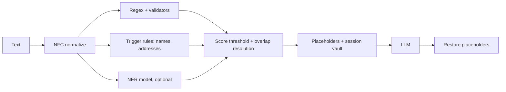

# vi-pii-guard

[](https://github.com/tranhoangluong/vi-pii-guard/actions/workflows/ci.yml)


**Detect and redact Vietnamese personal data before it reaches an LLM, then put it back in the answer.**

> *Phát hiện và che dữ liệu cá nhân tiếng Việt trước khi gửi lên LLM, rồi khôi phục lại trong câu trả lời.*

```text
User      Tôi tên là Nguyễn Văn An, SĐT 0912 345 678, CCCD 079204123456
LLM sees  Tôi tên là [PERSON_1], SĐT [PHONE_1], CCCD [NATIONAL_ID_1]
LLM says  Chào [PERSON_1], chúng tôi sẽ gọi lại số [PHONE_1].
User gets Chào Nguyễn Văn An, chúng tôi sẽ gọi lại số 0912 345 678.
```

## Why

Vietnam's Law on Personal Data Protection took effect on 1 January 2026, and penalties for
violations have applied since August 2026. Many teams still send raw customer messages to
foreign LLM APIs. Most PII tools are built for English; the Vietnamese ones are either
regex-first libraries or models trained on clinical text. `vi-pii-guard` targets everyday
Vietnamese text (customer support, banking, logistics), the identifiers specific to Vietnam, and
the full round trip through an LLM.

## Features

- **Vietnamese identifiers with validation**: 12-digit personal ID (province code, century/gender
  digit, birth year), tax codes (weighted checksum, branch suffix), mobile prefixes per carrier,
  Luhn-checked card numbers, license plates, passports.
- **Context scoring that works with or without diacritics**: "SĐT", "sdt" and "so dien thoai" all
  boost a phone match. Negative context separates look-alikes ("MST 0312345675" is a tax code,
  not a phone number).
- **Reversible, consistent placeholders**: the same value gets the same placeholder across a whole
  conversation, so the LLM can still reason ("[PERSON_1] called again").
- **Hybrid detection**: fast rules for structured PII, plus an optional fine-tuned NER model for
  names and addresses.
- **OpenAI-compatible proxy**: point an existing client at `http://localhost:8000/v1` and every
  request is redacted on the way out and restored on the way back.
- **Research tooling**: synthetic data generator with exact character spans, pre/post-2025
  address formats for drift experiments, span-level metrics plus privacy leak rates.
- **Zero-dependency core**: the library itself needs only the Python standard library.

## Quickstart

```bash
uv sync --extra api --group dev
```

### Library

```python
from vi_pii_guard import Guard

guard = Guard.default()  # rules only; add ner_model="models/xlmr-pii" for the hybrid mode
result = guard.redact("Họ tên: Trần Thị Mai, email mai.tran@example.vn")
print(result.text)  # Họ tên: [PERSON_1], email [EMAIL_1]

answer = "Đã gửi xác nhận tới [EMAIL_1]."
print(guard.restore(answer, result.session_id))  # Đã gửi xác nhận tới mai.tran@example.vn.
```

### CLI

```bash
uv run vi-pii-guard detect "STK 19034567890123 Techcombank, chủ tài khoản NGUYỄN VĂN AN"
uv run vi-pii-guard redact "CCCD 079204123456" --strategy mask   # -> CCCD [NATIONAL_ID]
echo "sdt 0987654321" | uv run vi-pii-guard redact -
```

### HTTP API and LLM proxy

```bash
cp .env.example .env            # set VPG_UPSTREAM_BASE_URL / VPG_UPSTREAM_API_KEY
uv run vi-pii-guard serve       # http://127.0.0.1:8000/docs
```

```python
from openai import OpenAI

client = OpenAI(base_url="http://127.0.0.1:8000/v1", api_key="unused-if-server-has-a-key")
reply = client.chat.completions.create(
    model="gpt-4o-mini",
    messages=[{"role": "user", "content": "Tôi là Lê Văn Nam, SĐT 0912345678. Tóm tắt giúp tôi."}],
)
print(reply.choices[0].message.content)  # original values restored
```

| Endpoint | Purpose |
|---|---|
| `POST /v1/detect` | List spans (type, offsets, score, source) |
| `POST /v1/redact` | Replace PII; returns `session_id` (originals are not echoed) |
| `POST /v1/restore` | Put originals back into text with placeholders |
| `DELETE /v1/sessions/{id}` | Forget a mapping as soon as a conversation ends |
| `POST /v1/chat/completions` | OpenAI-compatible proxy (non-streaming for now) |

Send `X-PII-Session` with the value returned in the previous response to keep placeholders
consistent across turns.

## Supported entities

| Type | Examples | How it is detected |
|---|---|---|
| `PERSON` | Nguyễn Văn An, chị Lan | trigger phrases (baseline) + NER |
| `ADDRESS` | 12 Lê Lợi, phường Bến Thành, TP. Hồ Chí Minh | trigger + admin keywords (baseline) + NER |
| `PHONE` | 0912 345 678, +84 912 345 678, 028 3822 1234 | regex + carrier prefix + context |
| `EMAIL` | an.nguyen@gmail.com | regex |
| `NATIONAL_ID` | 079204123456 (CCCD), 9-digit CMND with context | structure check + context |
| `PASSPORT` | C1234567 | regex + context |
| `TAX_CODE` | 0101234567, 0101234567-001 | checksum + context |
| `BANK_ACCOUNT` | STK 19034567890123 | context required |
| `CARD_NUMBER` | 4111 1111 1111 1111 | Luhn |
| `LICENSE_PLATE` | 51F-123.45, 59-X1 123.45 | regex + context |
| `DATE_OF_BIRTH` | sinh ngày 12/05/1990 | date + birth context required |

Details and edge cases: [docs/entities.md](docs/entities.md).

## How it works



The code follows ports and adapters: `Recognizer` and `Vault` are ports, regex rules and
Hugging Face models are adapters, and `Guard` is the application service.
See [docs/adr](docs/adr).

## Data, training and evaluation

```bash
# 1. Synthetic data (fictional values, structurally valid, with hard negatives)
uv run python scripts/generate_data.py --out data/synthetic

# 2. Rule baseline
uv run python scripts/evaluate.py --data data/synthetic/test.jsonl --name rules

# 3. Fine-tune NER (GPU recommended) and evaluate the hybrid system
uv sync --extra train
uv run python scripts/train_ner.py --train data/synthetic/train.jsonl \
    --dev data/synthetic/dev.jsonl --output models/xlmr-pii
uv run python scripts/evaluate.py --data data/synthetic/test.jsonl \
    --ner-model models/xlmr-pii --name hybrid --mlflow
```

Reports include exact and overlap F1 per type, **char leak rate** (share of gold PII characters
that would still reach the LLM), **entity leak rate**, false positives on PII-free texts, and
latency.

Rule baseline on 2,000 synthetic test texts (overlap match):

| Metric | Value |
|---|---:|
| Micro F1 | 0.961 |
| PERSON F1 | 0.919 |
| ADDRESS F1 | 0.891 |
| Char leak rate | 10.1% |
| False positives on PII-free texts | 0% |
| Latency p95 | < 0.2 ms per text |

These numbers are a sanity check, not a claim: the test texts come from the same templates the
rules were written against. Names typed without capitals, names without a trigger phrase and
addresses without "địa chỉ" are the main misses. Closing that gap, and measuring it on a
hand-labeled set of real-looking text, is the research part of the project
([docs/research](docs/research/README.md)).

## Limitations

- Not legal advice and no compliance guarantee. Redaction lowers risk; it does not remove the
  obligations of the law.
- The proxy does not support `stream=true` yet and does not redact tool-call arguments.
- Placeholder mappings live in process memory with a TTL. Multi-instance deployments need a
  shared vault adapter (for example Redis) behind the same `Vault` port.
- Rules for names and addresses are a baseline; use the NER model for production recall.

## Development

```bash
make check        # ruff, format check, mypy --strict, pytest
```

Never commit real personal data, including in tests and issues. See [SECURITY.md](SECURITY.md).

## License

[Apache-2.0](LICENSE)
